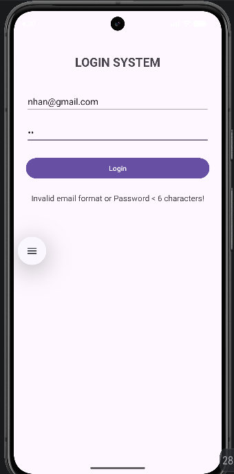
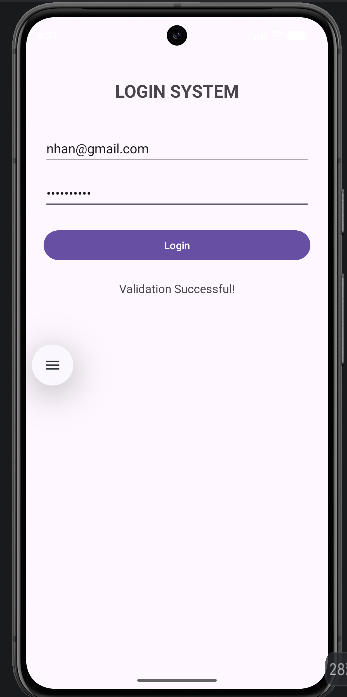

MOBILE APPLICATION DEVELOPMENT PRACTICAL EXAM
Full Name: Nguyen Tran Hoang Nhan

Student ID: 2474802010272

Class: 72K30CNTT01

University: Van Lang University VLU

QUESTION 1: Login System Interface and Validation
1. Implemented Technical Requirements:
   Designed a responsive user interface using ConstraintLayout.

Mapped mandatory UI components using findViewById including email EditText, password EditText, login Button, and status TextView.

Implemented input validation logic:

Checked for empty input fields (Email and Password cannot be blank).

Validated proper email format and verified password length is greater than or equal to 6 characters.

Displayed corresponding status messages for each scenario.

2. Evidence Screenshots:
Empty or Invalid Input Error:

Successful Login Validated:

